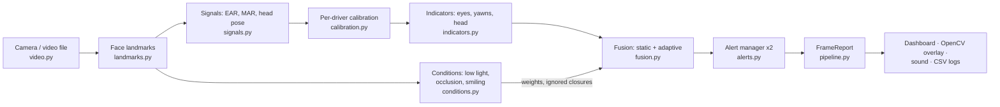

# Architecture

How the system works inside: the per-frame data flow, what each module does, the design rules the code follows, and how to extend it. For installing and running it, see the [README](README.md); for how it was evaluated, see [EVALUATION.md](EVALUATION.md).

## Contents

- [Data flow](#data-flow)
- [Where to start reading](#where-to-start-reading)
- [Modules](#modules)
- [Stage by stage](#stage-by-stage)
- [Design rules](#design-rules)
- [Extending the system](#extending-the-system)

## Data flow

`DrowsinessPipeline.process(frame, timestamp)` in [`pipeline.py`](src/drowsiness/pipeline.py) runs every stage for one frame and returns a `FrameReport`, an immutable snapshot of everything computed for that frame. The user interfaces ([`dashboard.py`](src/drowsiness/dashboard.py), [`cli.py`](src/drowsiness/cli.py) with [`overlay.py`](src/drowsiness/overlay.py)) only read `FrameReport`s; they never reach into the pipeline's state.

Both fusion strategies, static and adaptive, run on **every** frame from the same indicator scores, each with its own `AlertManager`. The configured strategy (`fusion.strategy`, adaptive by default) is the *active* one: it sounds the alarm and is logged. The other one is reported for comparison, which is how the dashboard shows both side by side and how the evaluation compares them on identical input.

## Where to start reading

1. [`pipeline.py`](src/drowsiness/pipeline.py), `DrowsinessPipeline.process`: the whole per-frame flow in about 80 lines.
2. [`signals.py`](src/drowsiness/signals.py): the measurements (EAR, MAR, head pose).
3. [`indicators.py`](src/drowsiness/indicators.py) and [`fusion.py`](src/drowsiness/fusion.py): how measurements become a drowsiness score.
4. [`conditions.py`](src/drowsiness/conditions.py): what makes this project different from fixed-weight fusion.
5. [`alerts.py`](src/drowsiness/alerts.py): how a score becomes an alert, and the safety rules.
6. [`config.py`](src/drowsiness/config.py) next to [`configs/default.toml`](configs/default.toml): every tunable value, with comments explaining where it came from.

## Modules

All code lives in the `drowsiness` package under `src/` (about 3,500 lines). Modules depend only on modules above them in this table, so there are no import cycles.

| Module | Responsibility | Main types |
|---|---|---|
| [`config.py`](src/drowsiness/config.py) | Typed configuration, loaded from TOML and validated | `AppConfig` and one dataclass per section |
| [`landmarks.py`](src/drowsiness/landmarks.py) | MediaPipe FaceLandmarker wrapper; picks the largest face as the driver; model download with checksum | `FaceLandmarker`, `FaceObservation` |
| [`signals.py`](src/drowsiness/signals.py) | Per-frame geometry: EAR, MAR, head pose | `FaceSignals`, `HeadPose` |
| [`calibration.py`](src/drowsiness/calibration.py) | 5-second per-driver baseline, with rejection and retries | `Calibrator`, `Baseline` |
| [`indicators.py`](src/drowsiness/indicators.py) | Time-based cue scores in [0, 1] | `EyeClosureIndicator`, `YawnIndicator`, `HeadTiltIndicator` and their `*State` |
| [`conditions.py`](src/drowsiness/conditions.py) | Low light, eye occlusion, smiling; smoothing and hysteresis | `ConditionDetector`, `Conditions` |
| [`fusion.py`](src/drowsiness/fusion.py) | Weighted fusion behind one interface | `FusionStrategy`, `StaticFusion`, `AdaptiveFusion` |
| [`alerts.py`](src/drowsiness/alerts.py) | Three-level alert state machine; CSV event log | `AlertManager`, `AlertLevel`, `AlertEvent`, `EventLog` |
| [`pipeline.py`](src/drowsiness/pipeline.py) | Per-frame orchestration | `DrowsinessPipeline`, `FrameReport` |
| [`learned.py`](src/drowsiness/learned.py) | Logistic-regression fusion (evaluated; shown live for comparison, never drives alerts) | `FeatureTracker`, `LogisticModel`, `LiveLearnedFusion` |
| [`evaluation.py`](src/drowsiness/evaluation.py) | Metrics shared by the evaluation tools | `replay_alerts`, `binary_metrics`, `roc_auc`, `detection_delays` |
| [`video.py`](src/drowsiness/video.py) | Camera or file input with timestamps and reconnection | `VideoSource` |
| [`audio.py`](src/drowsiness/audio.py) | Alarm sound per alert level (pygame) | `AlarmPlayer` |
| [`overlay.py`](src/drowsiness/overlay.py) | OpenCV drawing for `drowsiness run` | `draw` |
| [`recording.py`](src/drowsiness/recording.py) | Per-frame CSV output (`--record`, `process`) | `SignalRecorder` |
| [`cli.py`](src/drowsiness/cli.py) | Commands: `run`, `process`, `dashboard`, `download-model` | `main` |
| [`dashboard.py`](src/drowsiness/dashboard.py) | Streamlit dashboard | `main` |

## Stage by stage

### 1. Landmarks

MediaPipe's FaceLandmarker (Tasks API, video mode) returns 478 landmarks and 52 blendshape (expression) scores per face. Up to two faces are detected and the largest is tracked as the driver, so a passenger in the background is ignored.

### 2. Signals

Computed on every frame by `compute_signals`:

- **EAR** (Eye Aspect Ratio) from six landmarks around each eye: `(|p2-p6| + |p3-p5|) / (2 |p1-p4|)`, averaged over both eyes.
- **MAR** (Mouth Aspect Ratio): the mean of three inner-lip openings divided by the inner mouth width.
- **Head pitch, yaw and roll** from OpenCV `solvePnP` with a generic 3D face model.

### 3. Calibration

For the first 5 seconds the driver looks ahead with eyes open. The median values become that driver's `Baseline`:

- the closed-eye threshold is set to 60% of the open-eye EAR;
- head angles are measured relative to the neutral pose;
- the resting smile score is used by the smile detector.

This adapts the system to each driver's eye shape, glasses and camera position.

A baseline that doesn't look like open eyes facing ahead is rejected and calibration restarts. That covers open-eye EAR below 0.20 or above 0.45, and the head pitched more than 25°. After 3 rejected attempts the default thresholds are used and a warning stays on screen.

### 4. Indicators

These are based on time, not frame counts, so they don't depend on the frame rate.

- **Eyes:** the higher of two scores:
  - a **PERCLOS-like closed-eye ratio**: the share of the last 20 seconds with EAR below the calibrated threshold (a ratio of 0.4 scores 1);
  - the length of the current eye closure. A closure of 1.5 seconds or more counts as a **microsleep** and scores 1.

  A closure only ends once the eyes stay open for 0.15 s, so one noisy frame can't reset the microsleep timer.

  "Closed" here means EAR below 60% of the open-eye value (75% was tried first, but it also counted smiles, squints and looking down). That is looser than the ≥ 80%-eyelid-closure (P80) definition used by classic PERCLOS, so the ratio is not directly comparable with PERCLOS values in the literature.

  There are two eye indicators: the static one counts every closure; the adaptive one does not count closures while the driver is smiling.
- **Yawning:** the number of yawns in the last 60 seconds (3 yawns score 1). A yawn is the mouth held open (MAR above 0.45) for at least 1 second.
- **Head:** how long the head has been nodded forward by more than 15° or tilted sideways by more than 20° (2 seconds scores 1).

Yawns and head tilts are debounced like eye closures (0.2 s). A face dropout shorter than 0.3 s keeps every timer running; a longer one clears them, so time that was not observed is never counted as eyes closed.

### 5. Conditions

Every frame is checked for conditions that can mislead the eye cue:

- **Low light:** the mean brightness (0–255) of the **whole frame** is below 76. Cameras brighten dark scenes automatically, so at night the driver's face still looks normally lit (median 80 in real night footage), but the frame as a whole stays dark (median 52) because of the dark car and road.
- **Eye occlusion:** the eyes cannot be seen at all. A frame counts as occluded if:
  - there is glare on ≥ 15% of an eye region; or
  - the eye region is almost flat compared with the rest of the face (contrast ratio < 0.05: dark lenses, a hand); or
  - the two eyes read very differently while the head faces ahead and at least one eye is clearly open (one eye hidden).

  Clear glasses do not count, and closing both eyes never counts. Lightly tinted sunglasses are deliberately not flagged: the landmarks read the eyes through them as well as through clear glasses.
- **Smiling:** MediaPipe's smile score (mean of `mouthSmileLeft/Right`, averaged over 1 s) above 0.10 **and** at least 0.10 above the driver's resting smile. A wide-open mouth (MAR above the yawn threshold in the last 2 s) is a yawn, not a smile, even though MediaPipe scores 36–54% of yawn frames as smiles.

Low light and occlusion are smoothed over about 1 s with a time-based exponential moving average, and have separate enter and exit thresholds (low light starts below 76 and ends above 84), so a passing shadow or reflection does not switch them. How the thresholds were chosen on real footage is described in [EVALUATION.md](EVALUATION.md#condition-thresholds).

### 6. Fusion

The score is a weighted average of the three indicator scores. Both strategies implement the `FusionStrategy` protocol:

- **Static** (baseline): fixed weights, eyes 0.5, yawning 0.2, head 0.3; every eye closure counts.
- **Adaptive** (default, condition-aware): eye closures while **smiling** are not counted, and the weights change when the **eyes are occluded**. Otherwise it equals the static strategy, so any difference comes only from adapting.

| Condition | Eye | Yawn | Head |
|---|---|---|---|
| Normal | 0.50 | 0.20 | 0.30 |
| Low light | 0.50 | 0.20 | 0.30 |
| Eye region occluded | 0.20 | 0.35 | 0.45 |

Low light is detected, shown and logged, but keeps the normal weights: the evaluation showed the eye cue stays reliable at night ([EVALUATION.md](EVALUATION.md#what-the-evaluation-changed)). Setting `fusion.adapt_to_low_light = true` switches to the original low-light weights (0.20 / 0.35 / 0.45).

With several conditions, each cue gets its lowest weight before normalising. Weights move to new values over 1 s instead of jumping.

**Limits of the weights.** With the normal weights a single cue has a ceiling: yawning alone (max 0.2) never raises an alert; head tilt alone (max 0.3) only reaches Level 1; eye closure alone reaches Level 2 through the microsleep rule and Level 3 only by escalation.

### 7. Alerts

| Level | Trigger | Action |
|---|---|---|
| 1 Warning | score ≥ 0.25, or face not visible for 3 s | on-screen warning, held for at least 2 s |
| 2 Alarm | score ≥ 0.45, or a microsleep, or face not visible for 6 s | looping alarm sound, held for at least 1.5 s |
| 3 Critical | score ≥ 0.65, or Level 2 held for 5 s, or face not visible for 10 s | full-volume alarm, held for at least 5 s |

- **Hysteresis:** a margin of 0.05 stops the level flickering near a threshold.
- **Holds:** once raised, a warning stays for at least 2 s and an alarm sounds for at least 1.5 s, so neither blinks on and off (on real night footage the median warning lasted 0.4 s before this hold, 2.1 s after). An alarm steps down through a warning before returning to normal.
- **Microsleep override:** a microsleep forces an alarm in every condition. Under occlusion the eye weight (0.2) is below the warning threshold (0.25), so without this rule a real microsleep behind glare would raise no alert at all.
- **Failing loudly:** losing the face escalates to an audible alarm, and while the face is missing the level never goes down, because a slumped head or a blocked camera is exactly when the driver can't be watched. If the camera stops delivering frames, the app retries for 2 s and reopens the device once; if it is still gone, the alarm sounds until the user acknowledges it.
- **Logging:** every level change of the active strategy is written to `logs/alerts_<timestamp>.csv`. If that file can't be written (for example it's open in Excel), detection carries on and the missed rows are written later.

Recalibrating (the `c` key, or restarting detection in the dashboard) clears the alert state, so alerts are suppressed for the few seconds calibration takes.

### Learned fusion (comparison only)

[`learned.py`](src/drowsiness/learned.py) holds a logistic-regression alternative to the hand-set fusion. `FeatureTracker` computes 13 features from the last 10–30 s, using only the past, so the same code serves training and live use. `LogisticModel` is fitted with Newton's method (IRLS) in NumPy and saved as JSON ([`models/learned_fusion.json`](models/learned_fusion.json)). `LiveLearnedFusion` feeds it the live `FrameReport`s; the dashboard shows its output next to the two rule-based strategies, but it never drives the alarm. Why it was not adopted is in [EVALUATION.md](EVALUATION.md#learned-fusion).

## Design rules

These hold throughout the code; please keep them when changing it.

- **Time, not frames.** Every window, duration and debounce is in seconds, computed from frame timestamps, so behaviour is identical at 10, 15 or 30 fps.
- **Calibrated, not absolute.** Eye closure, head angles and smiling are judged relative to the driver's own baseline.
- **Identical input for comparison.** Static and adaptive fusion always see the same indicator scores; adaptive differs only where a condition applies.
- **Fail loudly.** Losing the face or the camera escalates the alert instead of going quiet.
- **Safety rules outside the fusion.** The microsleep and face-loss rules live in `AlertManager`, so no fusion strategy (including a learned one) can switch them off.
- **Every value in the config.** No magic numbers in the logic: thresholds and windows come from `config.py`, with a comment saying how each was chosen.
- **No images stored.** Only numbers (signals, scores, alert events) are ever written to disk.

## Extending the system

**Change a threshold or weight.** Copy [`configs/default.toml`](configs/default.toml), edit the value and run with `--config my.toml`. To change the default, edit both the dataclass in [`config.py`](src/drowsiness/config.py) and `configs/default.toml` (a test checks they agree), then check the effect on the datasets with [`tools/tune_detection.py`](tools/tune_detection.py).

**Add a configuration value.** Add a field to the relevant dataclass in `config.py` (with a validation check in its `__post_init__` if it has a valid range), add it to `configs/default.toml`, and add a test in `tests/test_config.py`.

**Add a condition.** Measure it in `conditions.measure` (add a field to `FrameConditions`), smooth and decide it in `ConditionDetector.update` (add a field to `Conditions`), then use it in `AdaptiveFusion.target` (a new weight row in `FusionConfig`) or in `DrowsinessPipeline._update_indicators`. Add it to `FrameReport.to_row` so it is logged, and to the dashboard badges.

**Add a fusion strategy.** Implement the `FusionStrategy` protocol (`name`, `fuse(scores, conditions, t)`, `reset()`) in `fusion.py`, and pass an instance to `DrowsinessPipeline(config, fusion=...)`. It receives the same `IndicatorScores` and `Conditions` as the built-in strategies.

**Add an output.** Read `FrameReport`s from the loop in `cli.py` or `dashboard.py`. Everything computed for a frame is in the report, and `FrameReport.to_row()` gives a flat dict for CSV output.

**Add a test.** Tests live in [`tests/`](tests), one file per module. Fast unit tests drive the classes with synthetic timestamps; end-to-end tests run the real model on the images in `tests/fixtures/`. See [CONTRIBUTING.md](CONTRIBUTING.md).
