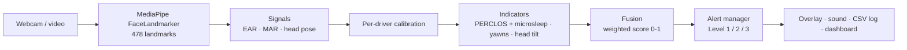

# Driver Drowsiness Detection

Real-time driver drowsiness detection with **condition-aware adaptive signal fusion**, built for the CS801 Computing Lab project (NITK Surathkal) by Yagnang Acharya (262IS037) and Akash Minz (262IS002).

The system tracks the driver's face from a webcam with MediaPipe. It combines three drowsiness cues (eye closure, yawning and head tilt) into one score and raises escalating alerts. The goal of the project is to re-weight those cues when conditions such as low light or glasses make some of them unreliable.

## Status

| Phase | Scope | State |
|---|---|---|
| 1 | Landmark pipeline; EAR, MAR, head pose | ✅ Done |
| 2 | Static-weight fusion, 3-level alerts, dashboard (working demo) | ✅ Done |
| 3 | Condition detection (low light, glasses) + adaptive fusion | Planned (CE‑2, Nov 1) |
| 4 | Evaluation vs. static baseline on datasets and own clips | Planned |
| 5 | Dashboard polish, documentation, final report | Planned (Endsem) |

## How it works



1. **Landmarks.** MediaPipe's FaceLandmarker (Tasks API) finds up to two faces and tracks the largest one as the driver.
2. **Signals, computed on every frame:**
   - **EAR** (Eye Aspect Ratio), from six landmarks around each eye.
   - **MAR** (Mouth Aspect Ratio), the inner-lip opening divided by the mouth width.
   - **Head pitch, yaw and roll**, from OpenCV `solvePnP` with a generic 3D face model.
3. **Calibration.** For the first 5 seconds the driver looks ahead with eyes open. The median values become that driver's baseline: the closed-eye threshold is set to 75% of the open-eye EAR, and head angles are measured relative to the neutral pose. This adapts the system to each driver's eye shape, glasses and camera position.
4. **Indicators.** These are based on time, not frame counts, so they don't depend on FPS:
   - **Eyes:** the higher of **PERCLOS** (the share of the last 20 seconds with eyes closed) and the length of the current eye closure (a closure of 1.5 seconds or more counts as a microsleep and gives a score of 1).
   - **Yawning:** the number of yawns in the last 60 seconds. A yawn is the mouth held wide open for at least 1.5 seconds.
   - **Head:** how long the head has been nodded forward by more than 15° or tilted sideways by more than 20°.
5. **Fusion.** The baseline (`StaticFusion`) is a fixed-weight average: eyes 0.5, yawning 0.2, head 0.3. Phase 3 adds an adaptive strategy behind the same interface, so both can be compared on identical inputs.
6. **Alerts:**

   | Level | Trigger | Action |
   |---|---|---|
   | 1 Warning | score ≥ 0.25, or face not visible for 3 s | on-screen warning |
   | 2 Alarm | score ≥ 0.45 | looping alarm sound |
   | 3 Critical | score ≥ 0.65, or Level 2 held for 5 s | full-volume alarm, held for at least 5 s |

   A small margin (hysteresis) stops the level flickering near a threshold. Every level change is written to `logs/alerts_<timestamp>.csv`.

## Setup

Requires **Python 3.11 or 3.12** (MediaPipe has no builds for newer versions yet) and a webcam.

```bash
py -3.12 -m venv .venv
.venv\Scripts\activate          # Windows
# source .venv/bin/activate     # Linux / macOS
pip install -e ".[dev]"
```

The face model (`models/face_landmarker.task`, 3.6 MB) is included in the repo. If it's missing, run `drowsiness download-model`, which downloads it and verifies its checksum.

## Usage

All commands are available as `drowsiness <command>` or `python -m drowsiness <command>`.

| Command | What it does |
|---|---|
| `drowsiness dashboard` | Streamlit dashboard: live video, signal values, indicator scores, score chart, alert history |
| `drowsiness run` | OpenCV window with overlay. Keys: `q` quits, `c` recalibrates |
| `drowsiness run --record session.csv` | the same, and also saves every frame's signals to a CSV |
| `drowsiness process clip.mp4` | analyses a video file without a window and writes per-frame signals to a CSV (used for evaluation) |
| `drowsiness download-model` | fetches the MediaPipe model |

Common options: `--config my.toml`, `--no-calibration`, `--no-sound` and `--source 1` (a camera index or a video file).

### Configuration

Every threshold, window and weight is set in [`configs/default.toml`](configs/default.toml). To change settings, copy the file, edit only what you need, and pass it with `--config`. Unknown keys and wrong value types are rejected with a clear error.

## Project structure

```
src/drowsiness/
  config.py        typed configuration + TOML loading/validation
  landmarks.py     MediaPipe FaceLandmarker wrapper, model download
  signals.py       EAR, MAR, head pose (solvePnP)
  calibration.py   per-driver baseline
  indicators.py    PERCLOS/microsleep, yawn, head-tilt scores
  fusion.py        fusion strategies (StaticFusion baseline)
  alerts.py        3-level alert state machine + CSV event log
  audio.py         alarm sound (pygame)
  pipeline.py      per-frame orchestration -> FrameReport
  overlay.py       OpenCV drawing
  video.py         camera / video-file frame source
  recording.py     per-frame CSV recorder
  cli.py           command-line interface
  dashboard.py     Streamlit dashboard
tests/             unit tests + end-to-end tests on real frames
configs/           default configuration
models/            MediaPipe face landmarker model
assets/            alarm sound, reference images
legacy/            original dlib/EAR-only version (prior work)
Docs/              reports and presentations
```

## Development

```bash
pytest                       # unit + end-to-end tests
ruff check src tests         # lint
ruff format src tests        # format
```

GitHub Actions runs lint and tests on Python 3.11 and 3.12 for every push and pull request.

## Tuning tips

- With glasses or narrow eyes, calibration normally handles the threshold. If false alarms continue, lower `ear_closed_ratio` (for example to 0.7).
- Mount the camera roughly at eye level, facing the driver. Head-pose angles are measured relative to the calibrated pose, so small offsets are fine.
- Press `c` (CLI) or restart detection (dashboard) to recalibrate after changing seats or lighting.

## References

1. C. Lugaresi et al., "MediaPipe: A Framework for Building Perception Pipelines," arXiv:1906.08172, 2019.
2. T. Soukupová and J. Čech, "Real-Time Eye Blink Detection using Facial Landmarks," CVWW, 2016.
3. Q. Ji, Z. Zhu and P. Lan, "Real-time nonintrusive monitoring and prediction of driver fatigue," IEEE Trans. Vehicular Technology, 53(4), 2004.

## License

[MIT](LICENSE)
