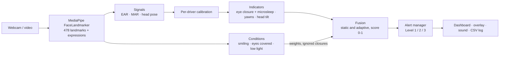

# Driver Drowsiness Detection

[](https://github.com/yagnangg333/Driver-Drowsiness-Detection/actions/workflows/ci.yml)


Real-time driver drowsiness detection from a webcam, with **condition-aware adaptive signal fusion**. Built for the CS801 Computing Lab project at NITK Surathkal by Yagnang Acharya (262IS037) and Akash Minz (262IS002).

The system tracks the driver's face with MediaPipe and measures three drowsiness cues: **eye closure**, **yawning** and **head nodding/tilting**. It combines them into one score that drives three alert levels. What makes it different from a fixed-weight detector: it recognises conditions in which a cue is misleading (smiling, covered eyes) and adapts how the cues are combined, so it raises **fewer false alarms without missing drowsiness**.

> [!WARNING]
> **A course prototype, not a safety device.** Its accuracy was measured on four public datasets, most with acted or per-video-labelled drowsiness, and it has not been tested in a real vehicle. Never rely on it while driving.

## At a glance

| | |
|---|---|
| **Input** | Webcam or video file |
| **Output** | Alert level per frame (warning, alarm, critical), alarm sound, live dashboard, CSV logs |
| **How** | MediaPipe face landmarks → eye/mouth/head signals → per-driver calibration → time-based indicators → condition-aware fusion → alert state machine |
| **Result** | Same recall as fixed-weight fusion (83.6%) with **half the alarm-level false alarms** (22.4% → 10.7%); on unseen people F1 **76.5% → 82.7%** ([details](EVALUATION.md)) |
| **Speed** | 10–15 ms per frame on a laptop CPU; no GPU needed |
| **Quality** | 185 automated tests, lint and tests in CI on every pull request |

## Contents

- [Quick start](#quick-start)
- [How it works](#how-it-works)
- [Results](#results)
- [Usage](#usage)
- [Repository layout](#repository-layout)
- [Documentation](#documentation)
- [Development](#development)
- [Status](#status)
- [References](#references)

## Quick start

Requires Python 3.11 or 3.12 and a webcam.

```bash
git clone https://github.com/yagnangg333/Driver-Drowsiness-Detection.git
cd Driver-Drowsiness-Detection
py -3.12 -m venv .venv
.venv\Scripts\activate          # Windows
# source .venv/bin/activate     # Linux / macOS
pip install -c constraints.txt -e ".[dev]"
drowsiness dashboard            # opens the dashboard in your browser
```

Turn on **Start detection**, look ahead with your eyes open for 5 seconds while it calibrates, then try it: smile (the static baseline warns, the adaptive strategy stays normal), close your eyes for 2 seconds (both raise an alarm), yawn, nod or cover the camera.

<details>
<summary>Installation notes</summary>

- [`constraints.txt`](constraints.txt) pins the versions tested on Python 3.12. Some (for example numpy 2.5) need Python 3.12 or newer, so on Python 3.11 leave out `-c constraints.txt`.
- Install in editable mode (`-e`) from a checkout: the code finds `models/`, `assets/` and `configs/` relative to the repository.
- The face model (`models/face_landmarker.task`, 3.6 MB) is included. If it's missing, `drowsiness download-model` downloads it and verifies its checksum.
- On Linux, MediaPipe and OpenCV also need `sudo apt-get install libgl1 libglib2.0-0 libegl1 libgles2`.
- Newer Python versions may work (MediaPipe 1.0 ships a version-independent wheel) but are not tested.

</details>

## How it works



1. **Landmarks:** MediaPipe finds the driver's face (478 points and expression scores).
2. **Signals:** Eye Aspect Ratio (EAR), Mouth Aspect Ratio (MAR) and head pitch/yaw/roll, every frame.
3. **Calibration:** 5 seconds of looking ahead set this driver's open-eye EAR, neutral head pose and resting expression.
4. **Indicators:** time-based scores for eye closure (PERCLOS-like ratio, and microsleeps of 1.5 s or more), yawns and head tilt.
5. **Conditions:** smiling (narrows the eyes without drowsiness), eyes covered (glare, dark glasses, a hand) and low light.
6. **Fusion:** two strategies run on every frame. **Static** uses fixed weights (eyes 0.5, yawn 0.2, head 0.3). **Adaptive** ignores eye closures while the driver smiles and shifts weight from the eyes to the mouth and head when the eyes are covered.
7. **Alerts:** warning, alarm and critical levels with hysteresis and minimum hold times. A microsleep or a lost face always raises an alarm.

The full description, module by module, is in **[ARCHITECTURE.md](ARCHITECTURE.md)**.

## Results

Evaluated on four public datasets (489 recordings, about 630,000 frames), with both strategies scored on identical frames:

| Dataset | Measure | Static | Adaptive |
|---|---|---|---|
| **NTHU-DDD** (frame labels) | F1, warning / alarm level | 76.6% / 71.8% | **80.9% / 76.4%** |
| | false-alarm rate, warning / alarm level | 34.8% / 22.4% | **23.1% / 10.7%** |
| | recall | 83.6% | 83.6% |
| | **held out** (unseen subjects): F1 / false alarms | 76.5% / 35.0% | **82.7% / 18.4%** |
| **YawDD** | talking clips with a false warning | 31% | **16%** |
| **UTA-RLDD** (real tiredness) | subjects whose drowsy video scores higher | 12/12 | 12/12 |
| **NITYMED** (night driving) | microsleep videos raising an alarm | 94.7% | 94.7% |

The improvement comes from not counting smiles and laughter as eye closures, the largest source of false alarms. A trained logistic-regression fusion was also evaluated and did not beat the rules on unseen subjects; the dashboard shows it live for comparison. Full results, method, findings and limitations: **[EVALUATION.md](EVALUATION.md)**.

## Usage

All commands are available as `drowsiness <command>` or `python -m drowsiness <command>`.

| Command | What it does |
|---|---|
| `drowsiness dashboard` | Streamlit dashboard: live video, static vs adaptive alert levels (and the trained model's output), signal values, indicator scores, score chart, alert history |
| `drowsiness run` | OpenCV window with overlay. Keys: `q` quits, `c` recalibrates |
| `drowsiness run --record session.csv` | the same, and also saves every frame's signals to a CSV |
| `drowsiness process clip.mp4` | analyses a video file without a window and writes per-frame signals to a CSV (used for evaluation) |
| `drowsiness download-model` | fetches the MediaPipe model |

Common options: `--config my.toml`, `--no-calibration`, `--no-sound`, `--source 1` (a camera index or a video file) and `--fusion static|adaptive` (which strategy drives the alerts; the CSV always has both scores, `static_score` and `adaptive_score`, plus the detected conditions and weights).

The dashboard runs one detection session at a time; a second browser tab is told to stop the first. Settings are locked while detection runs.

**Configuration.** Every threshold, window and weight is set in [`configs/default.toml`](configs/default.toml), with comments on how each was chosen. To change settings, copy the file, edit only what you need, and pass it with `--config`. Unknown keys and wrong value types are rejected with a clear error.

**Tuning tips.**
- With glasses or narrow eyes, calibration normally handles the threshold. If false alarms continue, lower `ear_closed_ratio` (for example to 0.55); raise it towards 0.7 to catch partly drooping eyes earlier, at the cost of more false alarms.
- Mount the camera roughly at eye level, facing the driver. Head angles are relative to the calibrated pose, so small offsets are fine.
- Recalibrate (`c` in the OpenCV window, or restart detection in the dashboard) after changing seats or lighting.

**Privacy and network access.**
- The dashboard streams the webcam **without any login**, so it only listens on this computer (`127.0.0.1`) by default, set by `drowsiness dashboard` and [`.streamlit/config.toml`](.streamlit/config.toml). Use `drowsiness dashboard --address 0.0.0.0` only on a network you trust; anyone who can reach it can watch the camera and control detection.
- No images or video are saved. Alert events go to `logs/`, and `--record`/`process` write per-frame signal values (EAR, MAR, head angles, scores) to CSV. These files say when a person appeared drowsy, so treat them as personal data. They're kept until you delete them, and `logs/` is excluded from Git.

## Repository layout

```
.
├── src/drowsiness/          the installable package (the detector itself)
│   ├── pipeline.py          per-frame orchestration: start reading here
│   ├── landmarks.py         MediaPipe FaceLandmarker wrapper, model download
│   ├── signals.py           EAR, MAR, head pose (solvePnP)
│   ├── calibration.py       per-driver baseline
│   ├── indicators.py        eye closure / microsleep, yawn and head-tilt scores
│   ├── conditions.py        smiling, eye occlusion and low-light detection
│   ├── fusion.py            static (baseline) and adaptive fusion
│   ├── alerts.py            3-level alert state machine, CSV event log
│   ├── learned.py           logistic-regression fusion (comparison only)
│   ├── evaluation.py        metrics shared by the evaluation tools
│   ├── config.py            typed configuration, TOML loading and validation
│   ├── video.py, audio.py   camera/video input, alarm sound
│   ├── overlay.py, recording.py   OpenCV drawing, per-frame CSV output
│   ├── cli.py               command-line interface
│   └── dashboard.py         Streamlit dashboard
├── tests/                   unit and end-to-end tests (one file per module)
│   └── fixtures/            two real face images for end-to-end tests
├── tools/                   evaluation and tuning scripts (need the datasets) - see tools/README.md
├── configs/default.toml     every threshold, window and weight
├── models/                  MediaPipe face model; trained learned-fusion model (JSON)
├── assets/                  alarm sound
├── data/                    datasets and evaluation outputs (not in Git) - see data/README.md
├── .github/workflows/       CI: lint and tests on Python 3.11 and 3.12
├── .streamlit/config.toml   dashboard server settings (local only)
├── pyproject.toml           package metadata, dependencies, ruff and pytest settings
└── constraints.txt          tested dependency versions
```

## Documentation

| Document | For | Contents |
|---|---|---|
| [README.md](README.md) | everyone | what it is, how to run it, results at a glance |
| [ARCHITECTURE.md](ARCHITECTURE.md) | developers | data flow, every module, design rules, how to extend |
| [EVALUATION.md](EVALUATION.md) | reviewers | datasets, method, full results, findings, limitations, how to reproduce |
| [CONTRIBUTING.md](CONTRIBUTING.md) | contributors | setup, checks, workflow, conventions |
| [tools/README.md](tools/README.md) | reproducing results | what each evaluation script reads and writes |
| [data/README.md](data/README.md) | reproducing results | where to get the datasets and where to put them |

## Development

```bash
pytest                              # unit + end-to-end tests
ruff check src tests tools          # lint
ruff format src tests tools         # format
```

GitHub Actions runs lint and tests on Python 3.11 and 3.12 for every push to `main` and every pull request. Tests check that the code behaves as designed; detection accuracy is measured separately on the datasets. See [CONTRIBUTING.md](CONTRIBUTING.md).

## Status

| Phase | Scope | State |
|---|---|---|
| 1 | Landmark pipeline; EAR, MAR, head pose | Done |
| 2 | Calibration, static fusion, 3-level alerts, dashboard | Done; the evaluation baseline |
| 3 | Condition detection and adaptive (expression-aware) fusion | Done; tuned on real footage |
| 4 | Evaluation against the static baseline on four public datasets; learned-fusion study | Done |
| 5 | Own recordings, hardware prototype (Raspberry Pi with an infrared camera), final report | Planned (end-semester) |

## References

1. C. Lugaresi et al., "MediaPipe: A Framework for Building Perception Pipelines," arXiv:1906.08172, 2019.
2. T. Soukupová and J. Čech, "Real-Time Eye Blink Detection using Facial Landmarks," CVWW, 2016.
3. Q. Ji, Z. Zhu and P. Lan, "Real-time nonintrusive monitoring and prediction of driver fatigue," IEEE Trans. Vehicular Technology, 53(4), 2004.
4. C.-H. Weng, Y.-H. Lai and S.-H. Lai, "Driver Drowsiness Detection via a Hierarchical Temporal Deep Belief Network," ACCV Workshops, 2016 (NTHU-DDD).
5. S. Abtahi, M. Omidyeganeh, S. Shirmohammadi and B. Hariri, "YawDD: A Yawning Detection Dataset," Proc. ACM Multimedia Systems, 2014.
6. R. Ghoddoosian, M. Galib and V. Athitsos, "A Realistic Dataset and Baseline Temporal Model for Early Drowsiness Detection," CVPR Workshops, 2019 (UTA-RLDD).
7. N. Petrellis et al., "NITYMED: Night-Time Yawning-Microsleep-Eyeblink-driver Distraction," IEEE DataPort, 2022, doi:10.21227/85xe-3f88.

The datasets are used for non-commercial academic evaluation under their own terms and are not redistributed with this repository.

## License

[MIT](LICENSE)
