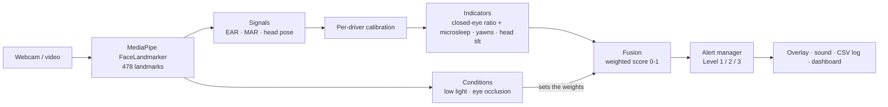

# Driver Drowsiness Detection

Real-time driver drowsiness detection with **condition-aware adaptive signal fusion**, built for the CS801 Computing Lab project (NITK Surathkal) by Yagnang Acharya (262IS037) and Akash Minz (262IS002).

The system tracks the driver's face from a webcam with MediaPipe. It combines three drowsiness cues (eye closure, yawning and head tilt) into one score and raises escalating alerts. The goal of the project is to adapt how those cues are combined when conditions such as smiling or covered eyes make some of them unreliable, cutting false alarms without missing drowsiness.

> [!WARNING]
> **This is a prototype built for a course project, not a safety device.** Its accuracy was measured on four public datasets (see [Evaluation results](#evaluation-results)), most of them with acted or per-video-labelled drowsiness, and it has not been tested in a real vehicle. Never rely on it while driving.

## Status

| Phase | Scope | State |
|---|---|---|
| 1 | Landmark pipeline; EAR, MAR, head pose | Done; checked on real footage |
| 2 | Static-weight fusion, 3-level alerts, dashboard (working demo) | Done; evaluated as the baseline |
| 3 | Condition detection + adaptive (expression-aware) fusion | Implemented, tuned on real footage |
| 4 | Evaluation vs. static baseline on four public datasets | Done ([results](#evaluation-results)); own clips pending |
| 5 | Dashboard polish, documentation, final report | Planned (Endsem) |

## How it works



1. **Landmarks.** MediaPipe's FaceLandmarker (Tasks API) finds up to two faces and tracks the largest one as the driver.
2. **Signals, computed on every frame:**
   - **EAR** (Eye Aspect Ratio), from six landmarks around each eye.
   - **MAR** (Mouth Aspect Ratio), the inner-lip opening divided by the mouth width.
   - **Head pitch, yaw and roll**, from OpenCV `solvePnP` with a generic 3D face model.
3. **Calibration.** For the first 5 seconds the driver looks ahead with eyes open. The median values become that driver's baseline: the closed-eye threshold is set to 60% of the open-eye EAR, and head angles are measured relative to the neutral pose. This adapts the system to each driver's eye shape, glasses and camera position.

   A baseline that doesn't look like open eyes facing ahead is rejected and calibration restarts. That covers open-eye EAR below 0.20 or above 0.45, and the head pitched more than 25°. After 3 rejected attempts the default thresholds are used and a warning stays on screen.
4. **Indicators.** These are based on time, not frame counts, so they don't depend on FPS:
   - **Eyes:** the higher of two scores:
     - a **PERCLOS-like closed-eye ratio**: the share of the last 20 seconds with EAR below the calibrated threshold;
     - the length of the current eye closure. A closure of 1.5 seconds or more counts as a microsleep and gives a score of 1.

     A closure only ends once the eyes stay open for 0.15 s, so one noisy frame can't reset the microsleep timer.

     "Closed" here means EAR below 60% of the open-eye value (75% was tried first, but it also counted smiles, squints and looking down). That is looser than the ≥ 80%-eyelid-closure (P80) definition used by classic PERCLOS, so the ratio is not directly comparable with PERCLOS values in the literature.
   - **Yawning:** the number of yawns in the last 60 seconds. A yawn is the mouth held open (MAR above 0.45) for at least 1 second; tuned on YawDD and checked on NITYMED.
   - **Head:** how long the head has been nodded forward by more than 15° or tilted sideways by more than 20°.
5. **Conditions.** Every frame is checked for conditions that can mislead the eye cue:
   - **Low light:** the mean brightness (0–255) of the **whole frame** is below 76. Cameras brighten dark scenes automatically, so at night the driver's face still looks normally lit (median 80 in real night footage), but the frame as a whole stays dark (median 52) because of the dark car and road.
   - **Eye occlusion:** the eyes cannot be seen at all. A frame counts as occluded if there is glare on ≥ 15% of an eye region, the eye region is almost flat compared with the rest of the face (contrast ratio < 0.05: dark lenses, a hand), or the two eyes read very differently while the head faces ahead and at least one eye is clearly open (one eye hidden). Clear glasses do not count, closing both eyes never counts, and lightly tinted sunglasses are deliberately not flagged: the landmarks read the eyes through them as well as through clear glasses.
   - **Smiling:** MediaPipe's smile score (mean of `mouthSmileLeft/Right`, averaged over 1 s) above 0.10 **and** at least 0.10 above the driver's resting smile, measured during calibration. Smiling and laughing narrow the eyes without drowsiness; on NTHU-DDD they caused most false eye closures. The resting-smile margin matters for safety: some faces and camera angles score above 0.10 at rest (without it, 21 of 105 YawDD normal-driving clips read as "smiling" most of the time, so those drivers' eye closures would have been ignored; with it, 5). A wide-open mouth (MAR above the yawn threshold in the last 2 s) is a yawn, not a smile, even though MediaPipe scores 36–54% of yawn frames as smiles.

   Both are smoothed over about 1 s with a time-based exponential moving average and have separate enter and exit thresholds (low light starts below 76 and ends above 84), so a passing shadow or reflection does not switch them.

   **How the thresholds were chosen.** The first thresholds came from artificially darkened or covered test photos and failed on real footage: low light never triggered at real night, and the occlusion check flagged up to 22% of frames with fully visible eyes. They were re-tuned on 15,319 frames from 482 real videos (NITYMED night driving, YawDD day driving with and without glasses or sunglasses, UTA-RLDD indoor webcams) with [`tools/condition_features.py`](tools/condition_features.py) and [`tools/tune_conditions.py`](tools/tune_conditions.py), choosing on half of the videos and checking on the other half. On the held-out half, and through the full pipeline:

   | Footage | Read as low light | Read as eyes occluded |
   |---|---|---|
   | Night driving (NITYMED) | 100% | 0.7% |
   | Day driving, no glasses (YawDD) | 0% | 0% |
   | Day driving, sunglasses (YawDD) | 0% | 1.3% |
   | Indoor webcam (UTA-RLDD) | 0% | 0% |

   The occlusion check was tuned to flag at most 3% of single frames of uncovered eyes in every dataset, because a false occlusion lowers the eye weight for a driver whose eyes are perfectly visible; the final contrast floor (0.05) flags no frame of any real dataset.
6. **Fusion.** The score is a weighted average of the three indicator scores. Two strategies share one interface and both run on every frame, so they are compared on identical inputs:
   - **Static** (baseline): fixed weights, eyes 0.5, yawning 0.2, head 0.3; every eye closure counts.
   - **Adaptive** (default, condition-aware): eye closures while **smiling** are not counted, and the weights change when the **eyes are occluded**. Otherwise it equals the static strategy, so any difference comes only from adapting.

   | Condition | Eye | Yawn | Head |
   |---|---|---|---|
   | Normal | 0.50 | 0.20 | 0.30 |
   | Low light | 0.50 | 0.20 | 0.30 |
   | Eye region occluded | 0.20 | 0.35 | 0.45 |

   **Why low light no longer changes the weights.** The original plan lowered the eye weight in low light. Real night driving (NITYMED) showed the eye cue stays reliable there: eye-measurement noise was 0.8% at night against 0.7% by day, and night "eyes closed" readings were real closures on inspection. Lowering the eye weight only discarded evidence (night microsleep videos raising an alarm fell from 94.7% to 84.2%). Low light is still detected, shown and logged, and keeps whatever the normal weights are; `fusion.adapt_to_low_light = true` switches to the original low-light weights (0.20 / 0.35 / 0.45).

   With several conditions, each cue gets its lowest weight before normalising. Weights move to new values over 1 s instead of jumping. A microsleep still forces an alarm in every condition: under occlusion the eye weight (0.2) is below the warning threshold (0.25), so without that rule a real microsleep behind glare would raise no alert at all.
7. **Alerts:**

   | Level | Trigger | Action |
   |---|---|---|
   | 1 Warning | score ≥ 0.25, or face not visible for 3 s | on-screen warning, held for at least 2 s |
   | 2 Alarm | score ≥ 0.45, or a microsleep, or face not visible for 6 s | looping alarm sound, held for at least 1.5 s |
   | 3 Critical | score ≥ 0.65, or Level 2 held for 5 s, or face not visible for 10 s | full-volume alarm, held for at least 5 s |

   A small margin (hysteresis) stops the level flickering near a threshold. Once raised, a warning stays for at least 2 s and an alarm sounds for at least 1.5 s, so neither blinks on and off (on real night footage the median warning lasted 0.4 s before this hold, 2.1 s after); an alarm steps down through a warning before returning to normal. While the face is missing the level never goes down. Yawns and head tilts are debounced like eye closures (0.2 s), and a face dropout shorter than 0.3 s keeps every timer running; a longer one clears them, so time that was not observed is never counted as eyes closed. Every level change is written to `logs/alerts_<timestamp>.csv`. If that file can't be written (for example it's open in Excel), detection carries on and the missed rows are written later.

   **Failing loudly.** Losing the face escalates to an audible alarm, because a slumped head or a blocked camera is exactly when the driver can't be watched. If the camera stops delivering frames, the app retries for 2 s and reopens the device once. If the camera is still gone, or monitoring stops for any other reason after it started, the alarm sounds until you acknowledge it.

   **Limits of the weights.** The fused score is a weighted average, so with the normal (static) weights a single cue has a ceiling:
   - Yawning alone (max 0.2) never raises an alert.
   - Head tilt alone (max 0.3) only reaches Level 1, which is visual only.
   - Eye closure alone reaches Level 2 from the microsleep rule and Level 3 only by escalation.

   Recalibrating (the `c` key, or restarting detection in the dashboard) clears the alert state, so alerts are suppressed for the few seconds calibration takes.

## Evaluation results

Phase 4 ran the full pipeline over four public datasets (489 recordings, about 630,000 frames) with [`tools/run_evaluation.py`](tools/run_evaluation.py); [`tools/evaluation_report.py`](tools/evaluation_report.py) produces the tables. Both strategies come from the same pass: the alert state machine is replayed over each strategy's score, so they are compared on identical input. The datasets live in `data/` (not in git); see the references.

| Dataset | What it measures | Static | Adaptive |
|---|---|---|---|
| **NTHU-DDD** (18,000 labelled frames, 4 subjects) | F1 at warning / alarm level | 76.6% / 71.8% | **80.9% / 76.4%** |
| | false-alarm rate at warning / alarm level | 34.8% / 22.4% | **23.1% / 10.7%** |
| | recall (warning level) | 83.6% | 83.6% |
| | ROC-AUC of the fused score | 0.823 | **0.883** |
| | **held out:** F1 / false alarms, smile settings chosen without the scored subject | 76.5% / 35.0% | **82.7% / 18.4%** |
| | drowsy episodes detected / median delay | 82.6% / 1.6 s | 82.6% / 1.6 s |
| **YawDD** (320 day-driving clips) | talking clips with a (false) warning | 31% | **16%** |
| | normal-driving clips with a (false) warning | 11.4% | **9.5%** |
| | yawning clips with a yawn detected | 68–77% | 68–77% |
| **UTA-RLDD** (36 ten-minute videos, real drowsiness) | AUC drowsy vs alert video (mean score) | 0.868 | 0.861 |
| | subjects whose drowsy video scores higher | 12/12 | 12/12 |
| **NITYMED** (126 night-driving videos) | microsleep videos raising an alarm | 94.7% | 94.7% |
| | yawns detected per video (3 performed) | 2.34 | 2.34 |

Adaptive fusion keeps every detection of the static baseline on NTHU-DDD (same recall) while cutting false alarms by a third at warning level and by half at alarm level; on subjects the smile settings never saw, F1 rises from 76.5% to 82.7%. The improvement comes from not counting smiles and laughter as eye closures, the largest source of false alarms in the data. The detection delay counts only drowsy episodes that start without an alert already on (23 of 41; the others are continuations of an earlier episode).

**How the settings were checked.** [`tools/replay.py`](tools/replay.py) re-runs everything after face tracking on the recorded signals (it matches the pipeline on 98.6–99.98% of frames), and [`tools/tune_detection.py`](tools/tune_detection.py) scores settings on all datasets. Every change was chosen on part of the data and checked on unseen data:

- The smile rule, tested leave-one-subject-out on NTHU-DDD, helps every subject (mean held-out F1 74.4% → 78.3%, false alarms 32.5% → 19.7%, recall unchanged).
- The yawn rule (MAR > 0.45 for 1.0 s instead of 0.5 for 1.5 s) was chosen on half of the YawDD drivers: yawns caught on the other half 56% → 69%, with one false yawn in about 50 talking clips; on NITYMED, 1.76 → 2.34 of 3 yawns per video.
- Rejected because they did not hold on unseen subjects: other eye-closure thresholds, a shorter or warm-up PERCLOS window, longer microsleep time, ignoring closures while the mouth stretches, letting the eye score alone raise alarms ("peak fusion", which raised false warnings on awake drivers from 23% to 41% of clips) and counting backward head tilts.

**Learned fusion (tried, not adopted).** We also trained a logistic regression on 13 windowed features (eye-closure fractions, closure length, blinks, relative EAR, yawn and head scores, mouth opening, nodding, smile, conditions) instead of hand-set weights ([`learned.py`](src/drowsiness/learned.py), [`tools/learned_fusion.py`](tools/learned_fusion.py), [`tools/learned_variants.py`](tools/learned_variants.py)). Every subject was predicted by a model that never saw them. No variant beat the rule-based adaptive fusion overall:

| Variant (held-out subjects) | NTHU F1 | NTHU false alarms | UTA AUC | YawDD awake warned | Night microsleep alarmed |
|---|---|---|---|---|---|
| **Rule-based adaptive (used)** | **80.9%** | **23.1%** | 0.861 | 12.7% | **94.7%** |
| Learned on NTHU-DDD, all features | 76.9% | 27.7% | 0.458 | 2.9% | 84.2% |
| Learned on NTHU-DDD, without smile and conditions | 72.4% | 29.6% | **0.917** | 4.4% | 84.2% |
| Learned on NTHU-DDD + UTA-RLDD, all features | 77.5% | 30.1% | 0.604 | 5.4% | 100% |

With four acted subjects the model learned the training set's habits (its largest weight said "smiling means alert") and did not transfer to real tiredness; each variant won on one dataset and lost on others. The safety rules (microsleep and face loss) stay in the alert manager in every variant.

**Limitations of the evaluation.** NTHU-DDD (Kaggle copy) has four subjects and acted drowsiness; UTA-RLDD and NITYMED have only per-video labels; no public dataset has dark sunglasses or hands over the eyes with drowsiness labels, so those cases are tested only with simulated frames. Processing times in the tables are with six recordings processed in parallel; live, the pipeline needs about 10–15 ms per frame.

## Setup

Requires **Python 3.11 or 3.12**, the versions CI tests on, and a webcam. Newer Python versions may work, since MediaPipe 1.0 ships a version-independent wheel, but they haven't been tested.

```bash
py -3.12 -m venv .venv
.venv\Scripts\activate          # Windows
# source .venv/bin/activate     # Linux / macOS
pip install -c constraints.txt -e ".[dev]"
```

[`constraints.txt`](constraints.txt) pins the dependency versions the project was tested with on Python 3.12. Some of them (for example numpy 2.5) need Python 3.12 or newer, so on Python 3.11 leave out `-c constraints.txt`; pip then picks the newest versions that support 3.11. Install in editable mode (`-e`) from a checkout: the code finds `models/`, `assets/` and `configs/` relative to the repository.

The face model (`models/face_landmarker.task`, 3.6 MB) is included in the repo. If it's missing, run `drowsiness download-model`, which downloads it and verifies its checksum.

On Linux, MediaPipe and OpenCV also need system libraries: `sudo apt-get install libgl1 libglib2.0-0 libegl1 libgles2`.

## Usage

All commands are available as `drowsiness <command>` or `python -m drowsiness <command>`.

| Command | What it does |
|---|---|
| `drowsiness dashboard` | Streamlit dashboard: live video, signal values, indicator scores, score chart, alert history |
| `drowsiness run` | OpenCV window with overlay. Keys: `q` quits, `c` recalibrates |
| `drowsiness run --record session.csv` | the same, and also saves every frame's signals to a CSV |
| `drowsiness process clip.mp4` | analyses a video file without a window and writes per-frame signals to a CSV (used for evaluation) |
| `drowsiness download-model` | fetches the MediaPipe model |

Common options: `--config my.toml`, `--no-calibration`, `--no-sound`, `--source 1` (a camera index or a video file) and `--fusion static|adaptive` (which strategy drives the alerts; the CSV always has both scores, `static_score` and `adaptive_score`, plus the detected conditions and weights).

The dashboard runs one detection session at a time; a second browser tab is told to stop the first. Settings are locked while detection runs.

### Privacy and network access

- The dashboard streams the webcam **without any login**, so it only listens on this computer (`127.0.0.1`) by default. That's set by `drowsiness dashboard` and by [`.streamlit/config.toml`](.streamlit/config.toml). Use `drowsiness dashboard --address 0.0.0.0` only on a network you trust; anyone who can reach it can watch the camera and control detection.
- No images or video are saved. Alert events go to `logs/`, and `--record`/`process` write per-frame signal values (EAR, MAR, head angles, scores) to CSV. These files say when a person appeared drowsy, so treat them as personal data. They're kept until you delete them, and `logs/` is excluded from git.

### Configuration

Every threshold, window and weight is set in [`configs/default.toml`](configs/default.toml). To change settings, copy the file, edit only what you need, and pass it with `--config`. Unknown keys and wrong value types are rejected with a clear error.

## Project structure

```
src/drowsiness/
  config.py        typed configuration + TOML loading/validation
  landmarks.py     MediaPipe FaceLandmarker wrapper, model download
  signals.py       EAR, MAR, head pose (solvePnP)
  calibration.py   per-driver baseline
  indicators.py    closed-eye ratio/microsleep, yawn, head-tilt scores
  conditions.py    low-light and eye-occlusion detection
  fusion.py        StaticFusion baseline + AdaptiveFusion
  learned.py       learned fusion (evaluated, not used live)
  alerts.py        3-level alert state machine + CSV event log
  audio.py         alarm sound (pygame)
  pipeline.py      per-frame orchestration -> FrameReport
  overlay.py       OpenCV drawing
  video.py         camera / video-file frame source
  recording.py     per-frame CSV recorder
  cli.py           command-line interface
  dashboard.py     Streamlit dashboard
tests/             unit tests + end-to-end tests on real frames
tools/             evaluation, offline replay, tuning and learned fusion (needs data/)
configs/           default configuration
models/            MediaPipe face landmarker model
assets/            alarm sound
```

## Development

```bash
pytest                       # unit + end-to-end tests
ruff check src tests         # lint
ruff format src tests        # format
```

GitHub Actions runs lint and tests on Python 3.11 and 3.12 for every push to `main` and every pull request.

The tests cover the signal maths, timing logic, alerts (including face loss and microsleep), condition detection and adaptive fusion, calibration rejection, config validation, camera dropouts, audio, the CLI and a dashboard smoke test. End-to-end tests run the real model on two recorded frames (and on copies with simulated low light, dark glasses, glare and a hand over one eye), and head-pose signs are checked against real face geometry. They check that the code behaves as designed; detection accuracy is measured separately on public datasets (see [Evaluation results](#evaluation-results)).

## Tuning tips

- With glasses or narrow eyes, calibration normally handles the threshold. If false alarms continue, lower `ear_closed_ratio` (for example to 0.55); raise it towards 0.7 to catch partly drooping eyes earlier, at the cost of more false alarms.
- Mount the camera roughly at eye level, facing the driver. Head-pose angles are measured relative to the calibrated pose, so small offsets are fine.
- Press `c` (CLI) or restart detection (dashboard) to recalibrate after changing seats or lighting.

## References

1. C. Lugaresi et al., "MediaPipe: A Framework for Building Perception Pipelines," arXiv:1906.08172, 2019.
2. T. Soukupová and J. Čech, "Real-Time Eye Blink Detection using Facial Landmarks," CVWW, 2016.
3. Q. Ji, Z. Zhu and P. Lan, "Real-time nonintrusive monitoring and prediction of driver fatigue," IEEE Trans. Vehicular Technology, 53(4), 2004.
4. C.-H. Weng, Y.-H. Lai and S.-H. Lai, "Driver Drowsiness Detection via a Hierarchical Temporal Deep Belief Network," ACCV Workshops, 2016 (NTHU-DDD).
5. S. Abtahi, M. Omidyeganeh, S. Shirmohammadi and B. Hariri, "YawDD: A Yawning Detection Dataset," Proc. ACM Multimedia Systems, 2014.
6. R. Ghoddoosian, M. Galib and V. Athitsos, "A Realistic Dataset and Baseline Temporal Model for Early Drowsiness Detection," CVPR Workshops, 2019 (UTA-RLDD).
7. N. Petrellis et al., "NITYMED: Night-Time Yawning-Microsleep-Eyeblink-driver Distraction," IEEE DataPort, 2022, doi:10.21227/85xe-3f88.

The datasets are used for non-commercial academic evaluation under their own terms and are not redistributed with this repository.

## License

[MIT](LICENSE)
